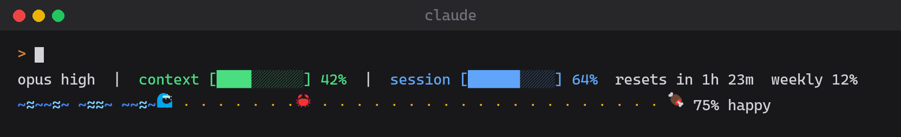

# shelldon

A 🦀 that lives in your Claude Code status line.



- It wanders a beach beside a rolling ocean.
- Every Claude turn feeds it the tokens it spent and drops a 🍤 on the beach; the crab walks up beside it and eats it.
- Food runs out over 3 days. Leave a repo alone for 7 days and its crab starves 🪦.
- One crab per repo, hatched the first time you open Claude Code there.

## Install

```
/plugin install shelldon --marketplace justinzau/shelldon
```

Answer `y` to add the marketplace, then pick a scope. Then put the crab in
your status line:

```
/crab setup
```

That's it. If you already have a status line, it stays exactly as it was,
with the crab on a line under it. `/crab setup undo` puts everything back.

What setup does: it copies a small script to `~/.claude/shelldon/statusline.sh`
and points `statusLine` in `~/.claude/settings.json` at it, refreshed every
second. Your previous status line command, if any, is saved beside the script,
and the script runs it first.

## Or wire it into your own script

The plugin writes each frame, ANSI-colored, to
`~/.claude/shelldon/frames/<session_id>.txt`. To print it from a status line
script of your own instead, set `"refreshInterval": 1` on your `statusLine`
and add this to the end of the script. It starts no processes: the session id
is cut out with parameter expansion, and the frame is read with the shell's
own `read` (no `jq`, no `cat`). `/crab setup` notices a script that does this
and leaves it alone.

```sh
# input holds the JSON Claude Code sent on stdin, e.g. read with:
#   IFS= read -r -d '' input        (bash; fork-free, unlike input=$(cat))
case $input in
  *'"session_id"'*)
    rest=${input#*'"session_id"'}; rest=${rest#*'"'}; session_id=${rest%%'"'*}
    crab_frame="$HOME/.claude/shelldon/frames/${session_id}.txt"
    if [ -n "$session_id" ] && [ -s "$crab_frame" ]; then
      IFS= read -r crab < "$crab_frame" || [ -n "$crab" ]
      printf '%s\n' "$crab"
    fi ;;
esac
```

## Performance

- **No tokens.** The plugin never calls the model; it reads the token counts
  Claude Code already reports at the end of each turn.
- **No background processes.** One timer inside Claude Code ticks once a
  second, and writes the frame file only when the scene changed.
- **It dozes.** After 10 minutes without a turn the scene stops moving and
  redraws once a minute. The next turn wakes it.
- **The status line command is the real cost**, since `refreshInterval: 1`
  runs it every second. Keep it fast: every process it starts (a pipe,
  `$(...)`, `cat`, each `jq`) costs about 1ms on macOS and Linux but about
  70ms under Git Bash on Windows. Setup's script starts none of its own; a
  status line it wraps costs whatever that command costs. In a script of your
  own, do your fields in one `jq` call, feed it with a here-string
  (`jq ... <<< "$input"`) rather than a pipe, and use the snippet above for
  the crab. Claude Code cancels a run still going when the next refresh
  fires, so a slow script shows no crab at all.
- Want it lighter still? `refreshInterval: 2` halves the cost; the crab
  moves in two-second hops.

## Commands

- `/crab` shows its mood, age and how long until it starves.
- `/crab setup` puts the crab in your status line; `/crab setup undo` takes it out.
- `/crab hatch` hatches a new crab once the old one has died.

## Develop

```
claude --plugin-dir .
claude plugin validate .
claude plugin test .
```

Tune the crab in `hooks/crab.ts` (food, decay, speeds, colors) and `hooks/register.ts` (frame rate).

The preview GIF is drawn from the real crab logic: `docs/preview/frames.mjs`
plays a short story through `hooks/crab.ts` (Node 23.6+ runs the TypeScript
directly), and `docs/preview/render.py` paints it with Pillow. The fonts are
Windows' Cascadia Mono and Segoe UI Emoji; point `render.py` elsewhere on
other systems.

```
node docs/preview/frames.mjs . frames.json
python docs/preview/render.py frames.json docs/preview.gif
```
